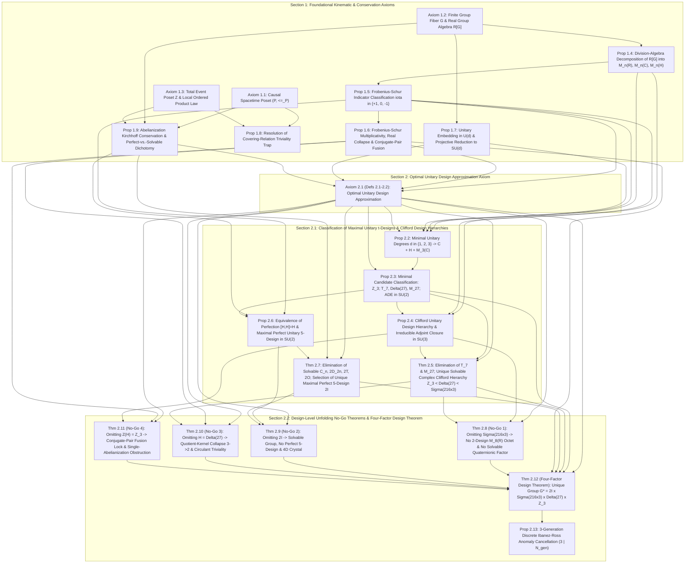

# Deductive Dependency Graph: From Axioms 1.1–1.3 and Axiom 2.1 to the Four-Factor Design Theorem (Theorem 2.12) and Companion Papers II–III

This document traces the complete deductive dependency graph of Paper I ([`paper.tex`](paper.tex#L85-L404)) from the four foundational axioms (**Axioms 1.1–1.3** in Section 1 and **Axiom 2.1**, *Optimal Unitary Design Approximation*, in Section 2) through the intermediate propositions and no-go theorems to the **Four-Factor Design Theorem** (**Theorem 2.12**, `\label{thm:design}`) and **Proposition 2.13** (`\label{prop:anomaly_cancellation}`), which in turn provide the algebraic input $\Gstar = 2I \times \Sigma(216 \times 3) \times \Delta(27)_f \times \Z_3^{\mathrm{PQ}}$ for the 4D Poset Collider simulations in Paper II ([`paper2.tex`](paper2.tex)) and the Quaternionic Cartan Soldering / Causal Set Inverse Problem theorems (Propositions 1.2–1.3 and Theorems 2.1, 2.3–2.4) in Paper III ([`paper3.tex`](paper3.tex)).

---

## Mermaid Deductive Dependency Graph

---

## Step-by-Step Deductive Ledger

| Node | Statement in [`paper.tex`](paper.tex) | Direct Inputs | Mathematical Output Fed Forward |
| :--- | :--- | :--- | :--- |
| **[Axiom 1.1](paper.tex#L85-L88)** | Causal Spacetime Poset $(P, \le_P)$ | Foundational postulate | Directed covering links $x \prec_P y$ |
| **[Axiom 1.2](paper.tex#L90-L93)** | Finite Group Fiber $G$ and Real Group Algebra $\R[G]$ | Foundational postulate | Finite group $G$ and semisimple real algebra $\R[G]$ |
| **[Axiom 1.3](paper.tex#L95-L107)** | Total Event Poset $Z \subseteq P \times G$ & Ordered Product Law | Foundational postulate | Induced strict order $\prec_Z$ and vertex equation $\prod u_{\sigma(i)} = \prod v_{\tau(j)}$ |
| **[Prop 1.4](paper.tex#L109-L120)** | Division-Algebra Decomposition of $\R[G]$ | Axiom 1.2 (Maschke, Artin–Wedderburn, Frobenius) | $\R[G] \cong \bigoplus M_{n_\alpha}(\mathbb{D}_\alpha)$ with $\mathbb{D}_\alpha \in \{\R, \C, \quat\}$ |
| **[Prop 1.5](paper.tex#L122-L134)** | Frobenius–Schur Classification of Simple Components of $\R[G]$ | Axiom 1.2, Prop 1.4 | $\iota(\chi) \in \{+1, 0, -1\} \leftrightarrow \{\R, \C, \quat\}$ and $d_\chi = 2n_\alpha$ for $\quat$ |
| **[Prop 1.6](paper.tex#L136-L152)** | Frobenius–Schur Multiplicativity, Real Collapse, and Conjugate-Pair Fusion | Prop 1.5 | $\iota(\bigboxtimes \chi_j) = \prod \iota(\chi_j)$, real/abelian-triplet collapse ($\iota = (-1)(-1) = +1$ and $3 \to 2$), and conjugate-pair fusion $\rho_{\bar{\chi}}(x) = \rho_\chi(x)^*$ in $M_{d_\chi}(\C)$ |
| **[Prop 1.7](paper.tex#L154-L161)** | Unitary and Special Unitary Embedding of Finite Group Representations | Axiom 1.2 (Weyl's theorem) | Every representation embeds into $\U(d_\chi)$, and projective tensor conjugation ($d_\chi \ge 2$) factors through $\PU(d_\chi) \cong \SU(d_\chi)/\Z_{d_\chi}$ and embeds at minimal order into $\SU(d_\chi)$ |
| **[Prop 1.8](paper.tex#L163-L170)** | Resolution of Covering-Relation Triviality Trap | Axioms 1.1, 1.3 | Antichain fibers $Z_x$ and covering equivalence $\prec_Z \iff \prec_P$ |
| **[Prop 1.9](paper.tex#L172-L184)** | Abelianization Kirchhoff Conservation Law & Perfect-vs.-Solvable Dichotomy | Axioms 1.1, 1.2, 1.3 | Additive charge conservation in $G^{\mathrm{ab}} = G/[G,G]$, partitioning subgroups into solvable ($K^{\mathrm{ab}} \neq \{1\}$) and perfect ($[K,K]=K \iff K^{\mathrm{ab}} = \{1\}$) |
| **[Axiom 2.1 / Defs 2.1–2.2](paper.tex#L192-L209)** | Optimal Unitary Design Approximation | Props 1.5–1.7, 1.9 & algebraic design optimality postulate | $\Gstar$ is the finite group of minimal order and minimal exponent whose real group algebra $\R[\Gstar]$ simultaneously and faithfully realizes, without real collapse or conjugate-pair fusion, the maximal-degree perfect projective unitary $t$-design and every level of the minimal solvable complex ($\iota = 0$) Clifford unitary design hierarchy |
| **[Prop 2.2](paper.tex#L223-L236)** | Minimal Unitary Degrees of Non-Real Division Algebras | Props 1.4, 1.5, 1.7, Axiom 2.1 | $d_\chi = 1$ ($\U(1) \to \C$), $d_\chi = 2$ ($\SU(2) \to \quat$), $d_\chi = 3$ ($\SU(3) \to M_3(\C)$) |
| **[Prop 2.3](paper.tex#L238-L250)** | Classification of Minimal Finite Group Candidates | Prop 2.2, Axiom 2.1 | Selects $\Z_3 \subset \U(1)$; candidates $\{T_7, \Delta(27), M_{27}\} \subset \SU(3)$; ADE candidates $\{C_n, 2D_{2n}, 2T, 2O, 2I\} \subset \SU(2)$ |
| **[Prop 2.4](paper.tex#L254-L266)** | Clifford Unitary Design Hierarchy & Irreducible Adjoint Closure in $\SU(3)$ | Props 1.4, 1.5, 2.3, Defs 2.1–2.2 | Equivalence: $9$-element $1$-design basis $H/Z(H)$ + $2$-design irreducible $N_{\SU(3)}(H)$ action $\iff |H|=27, \text{exp } 3 \iff H \cong \Delta(27), N_{\SU(3)}(H) \cong \Sigma(216\times 3)$ and irrep classification $\Delta[0..10], \Sigma[0..23]$ |
| **[Thm 2.5](paper.tex#L268-L275)** | Elimination of $T_7$ and $M_{27}$; Selection of $\Delta(27)$ & $\Sigma(216\times 3)$ | Axiom 2.1, Props 2.3, 2.4 | Rules out $T_7$ and $M_{27}$; proves $1 \triangleleft \Z_3 \triangleleft \Delta(27) \triangleleft \Sigma(216 \times 3)$ is the unique minimal solvable complex ($\iota = 0$) Clifford unitary design hierarchy |
| **[Prop 2.6](paper.tex#L279-L291)** | Equivalence of Perfection & Maximal Perfect Unitary $5$-Design in $\SU(2)$ | Props 1.5, 1.9, 2.3, Def 2.1 | Equivalence in $\SU(2)$: $[H,H]=H \iff \mathbf{2}_{-1} \oplus \mathbf{2}_{-1}'$ (unique maximal perfect $5$-design) $\iff H \cong 2I$ with $5$ real ($A_5, z_{\mathrm{spin}}=+1$) and $4$ quaternionic ($z_{\mathrm{spin}}=-1$) irreps ($\sum d_\chi^2 = 60 + 60$) |
| **[Thm 2.7](paper.tex#L293-L300)** | Elimination of Solvable $C_n, 2D_{2n}, 2T, 2O$; Selection of $2I$ | Axiom 2.1, Props 1.9, 2.6 | Rules out solvable ADE subgroups; selects unique maximal-degree perfect unitary $5$-design $2I \subset \SU(2)$ |
| **[Thm 2.8](paper.tex#L306-L313)** | No-Go 1: Eliminating All Subsets Omitting $\Sigma(216 \times 3)$ | Axiom 2.1, Prop 2.4, Thm 2.5 | Violates Axiom 2.1: without $\Sigma(216\times 3) = \Delta(27) \rtimes 2T$, no $2$-design $M_8(\R)$ octet and no solvable quaternionic subgroup independent of $2I$ exist |
| **[Thm 2.9](paper.tex#L315-L322)** | No-Go 2: Eliminating All Subsets Omitting $2I$ | Axiom 2.1, Prop 2.6, Thm 2.7 | Violates Axiom 2.1: without $2I$, $G$ is solvable and all $d_\R \le 4$ irreps have $\Delta(27)$ in their kernel with crystallographic traces |
| **[Thm 2.10](paper.tex#L324-L331)** | No-Go 3: Eliminating All Subsets Omitting $H \cong \Delta(27)$ | Axiom 2.1, Prop 1.6, Thm 2.5 | Violates Axiom 2.1: on $\Delta(27)$-trivial quotient representations, abelian $\Z_3$ triplets collapse $3 \to 2$ simple Wedderburn components and force $\Z_3$-circulant matrices ($|U_1^\dagger U_2| = I_3$) |
| **[Thm 2.11](paper.tex#L333-L345)** | No-Go 4: Eliminating Ungraded $G_3$ (Omitting $Z(H) \cong \Z_3$) | Axiom 2.1, Prop 1.6, Prop 2.4 | Violates Axiom 2.1: conjugate quotient doublets $\Sigma[4],\Sigma[3]$ fuse into one $M_2(\C)$ component locking $\Tr(M^{(1)}M^{(1)\dagger}) = \Tr(M^{(2)}M^{(2)\dagger})$ unless separated by $Z(H) \cong \Z_3$ |
| **[Thm 2.12](paper.tex#L347-L363)** | **Four-Factor Design Theorem for $\Gstar$** | Axiom 2.1, Prop 1.6, Prop 2.3(1), Thms 2.5, 2.7, Thms 2.8–2.11 | Uniquely selects $\Gstar = 2I \times \Sigma(216 \times 3) \times \Delta(27) \times \Z_3$ (order $6{,}298{,}560$) from the $1 + 3 = 4$ design levels |
| **[Prop 2.13](paper.tex#L393-L404)** | 3-Generation Discrete Ibáñez–Ross Anomaly Cancellation | Thm 2.12, Table 1 | Single-generation discrete anomalies $\equiv (1,1,1) \pmod 3$ cancel iff $3 \mid N_{\mathrm{gen}}$ ($N_{\mathrm{gen}} = \dim\mathbf{3}_f = 3$) |
