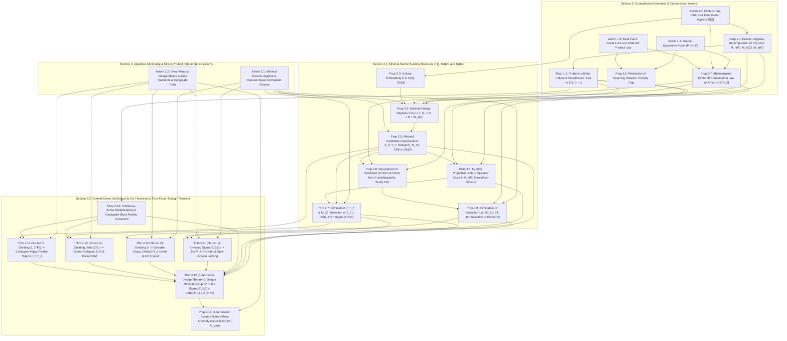

# Deductive Dependency Graph: From Axioms 1.1–1.3 and 2.1–2.2 to the Four-Factor Design Theorem (Theorem 2.15)

This document traces the complete deductive dependency graph from the five foundational axioms (**Axioms 1.1–1.3** in Section 1 and **Axioms 2.1–2.2** in Section 2) through the intermediate propositions and no-go theorems to the **Four-Factor Design Theorem** (**Theorem 2.15**, `\label{thm:design}`) and **Proposition 2.16** (`\label{prop:anomaly_cancellation}`) in [`paper.tex`](paper.tex#L85-L359).

---

## Mermaid Deductive Dependency Graph

---

## Step-by-Step Deductive Ledger

| Node | Statement in [`paper.tex`](paper.tex) | Direct Inputs | Mathematical Output Fed Forward |
| :--- | :--- | :--- | :--- |
| **[Axiom 1.1](paper.tex#L85-L88)** | Causal Spacetime Poset $(P, \le_P)$ | Foundational postulate | Directed covering links $x \prec_P y$ |
| **[Axiom 1.2](paper.tex#L90-L93)** | Finite Group Fiber $G$ and Real Group Algebra $\R[G]$ | Foundational postulate | Finite group $G$ and semisimple real algebra $\R[G]$ |
| **[Axiom 1.3](paper.tex#L95-L107)** | Total Event Poset $Z \subseteq P \times G$ & Ordered Product Law | Foundational postulate | Induced strict order $\prec_Z$ and vertex equation $\prod u_{\sigma(i)} = \prod v_{\tau(j)}$ |
| **[Prop 1.4](paper.tex#L109-L120)** | Division-Algebra Decomposition of $\R[G]$ | Axiom 1.2 (Maschke, Artin–Wedderburn, Frobenius) | $\R[G] \cong \bigoplus M_{n_\alpha}(\mathbb{D}_\alpha)$ with $\mathbb{D}_\alpha \in \{\R, \C, \quat\}$ |
| **[Prop 1.5](paper.tex#L122-L134)** | Frobenius–Schur Classification of Blocks of $\R[G]$ | Axiom 1.2, Prop 1.4 | $\iota(\chi) \in \{+1, 0, -1\} \leftrightarrow \{\R, \C, \quat\}$ and $d_\chi = 2n_\alpha$ for $\quat$ |
| **[Prop 1.6](paper.tex#L136-L143)** | Resolution of Covering-Relation Triviality Trap | Axioms 1.1, 1.3 | Antichain fibers $Z_x$ and covering equivalence $\prec_Z \iff \prec_P$ |
| **[Prop 1.7](paper.tex#L145-L157)** | Abelianization Kirchhoff Conservation Law | Axioms 1.1, 1.2, 1.3 | Additive charge conservation in $G^{\mathrm{ab}} = G/[G,G]$ ($G^{\mathrm{ab}} \neq \{1\}$ vs. $[K,K]=K$) |
| **[Axiom 2.1](paper.tex#L165-L168)** | Minimal Division-Algebra & Operator-Basis Normalizer Closure | Algebraic minimality postulate | Requires $\{\R,\C,\quat\}$ in perfect/solvable & abelian/non-abelian sectors at minimal $(d_\chi, |H|, \text{exp})$ with irreducible $N_{\SU(d_\chi)}(H)$ action on traceless $H/Z(H)$ |
| **[Axiom 2.2](paper.tex#L170-L173)** | Direct-Product Independence Across Quotients & Conjugate Pairs | Algebraic independence postulate | Quotient kernels retain independent operator-basis action; conjugate doublets of $N_{\SU(d_\chi)}(H_c)/H_c$ occupy disjoint blocks with zero discrete anomalies |
| **[Prop 2.3](paper.tex#L184-L191)** | Unitary Embedding of Finite Group Representations | Axiom 1.2 (Weyl's theorem) | Every finite subgroup embeds into $\U(d_\chi)$ or $\SU(d_\chi)$ |
| **[Prop 2.4](paper.tex#L193-L206)** | Minimal Unitary Degrees of Non-Real Division Algebras | Props 1.4, 1.5, 1.7, 2.3, Axiom 2.1 | $d_\chi = 1$ ($\U(1) \to \C$), $d_\chi = 2$ ($\SU(2) \to \quat$), $d_\chi = 3$ ($\SU(3) \to M_3(\C)$) |
| **[Prop 2.5](paper.tex#L208-L221)** | Classification of Minimal Finite Group Candidates | Prop 2.4, Axiom 2.1 | Selects $\Z_3 \subset \U(1)$; candidates $\{T_7, \Delta(27), M_{27}\} \subset \SU(3)$; ADE candidates $\{C_n, 2D_{2n}, 2T, 2O, 2I\} \subset \SU(2)$ |
| **[Prop 2.6](paper.tex#L225-L237)** | $M_3(\C)$ Operator Basis & Irreducible $M_8(\R)$ Normalizer Closure | Props 1.4, 1.5, 2.5 | Equivalence: $9$-element basis $H/Z(H)$ + transitive $N_{\SU(3)}(H)$ action $\iff |H|=27, \text{exp } 3 \iff H \cong \Delta(27), N_{\SU(3)}(H) \cong \Sigma(216\times 3)$ |
| **[Thm 2.7](paper.tex#L239-L246)** | Elimination of $T_7$ and $M_{27}$; Selection of $\Delta(27)$ & $\Sigma(216\times 3)$ | Axiom 2.1, Props 2.5, 2.6 | Rules out $T_7$ and $M_{27}$; yields normal series $\Z_3 \triangleleft \Delta(27) \triangleleft \Sigma(216 \times 3)$ |
| **[Prop 2.8](paper.tex#L250-L262)** | Equivalence of Perfection & Chiral Non-Crystallographic $\SU(2)$ Pair | Props 1.5, 1.7, 2.5 | Equivalence in $\SU(2)$: $[H,H]=H \iff \mathbf{2}_{-1} \oplus \mathbf{2}_{-1}'$ ($5$-design) $\iff H \cong 2I$ |
| **[Thm 2.9](paper.tex#L264-L271)** | Elimination of Solvable $C_n, 2D_{2n}, 2T, 2O$; Selection of $2I$ | Axiom 2.1, Props 1.7, 2.8 | Rules out solvable ADE subgroups; selects $G_{\mathrm{spin}} = 2I$ |
| **[Prop 2.10](paper.tex#L277-L291)** | Frobenius–Schur Multiplicativity & Conjugate-Block Reality | Prop 1.5 | $\iota(\bigboxtimes \chi_j) = \prod \iota(\chi_j)$ and Hermitian conjugation $\rho_{\bar{\chi}}(x) = \rho_\chi(x)^*$ on shared complex blocks $M_{d_\chi}(\C)$ |
| **[Thm 2.11](paper.tex#L295-L302)** | No-Go 1: Eliminating All Subsets Omitting $\Sigma(216 \times 3)$ | Axioms 2.1, 2.2, Prop 2.6, Thm 2.7 | Without $\Sigma(216\times 3) = \Delta(27) \rtimes 2T$, no $M_8(\R)$ octet exists and weak $\SU(2)$ is locked to $2I$ |
| **[Thm 2.12](paper.tex#L304-L311)** | No-Go 2: Eliminating All Subsets Omitting $2I$ | Axioms 2.1, 2.2, Thm 2.9 | Without $2I$, $G$ is solvable and all $d_\R \le 4$ irreps have $\Delta(27)_c$ in their kernel with crystallographic traces |
| **[Thm 2.13](paper.tex#L313-L320)** | No-Go 3: Eliminating All Subsets Omitting $\Delta(27)_f$ | Axiom 2.2, Prop 2.10, Thm 2.7 | On $\Delta(27)_c$-trivial states, abelian $\Z_3$ flavor collapses $3 \to 2$ blocks over $\R$ and forces $V_{\mathrm{CKM}} = I_3$ |
| **[Thm 2.14](paper.tex#L322-L334)** | No-Go 4: Eliminating Ungraded $G_3$ (Omitting $\Z_3^{\mathrm{PQ}}$) | Axiom 2.2, Prop 2.10, Prop 2.5(1) | Conjugate doublets $\Sigma[4],\Sigma[3]$ fuse into one $M_2(\C)$ block locking $m_t \approx m_b$ unless graded by $\Z_3^{\mathrm{PQ}}$ |
| **[Thm 2.15](paper.tex#L336-L346)** | **Four-Factor Design Theorem for $\Gstar$** | Prop 2.5(1), Thms 2.7, 2.9, Prop 2.10, Thms 2.11–2.14 | Uniquely selects $\Gstar = 2I \times \Sigma(216 \times 3) \times \Delta(27)_f \times \Z_3^{\mathrm{PQ}}$ (order $6{,}298{,}560$) |
| **[Prop 2.16](paper.tex#L348-L359)** | 3-Generation Discrete Ibáñez–Ross Anomaly Cancellation | Axiom 2.2, Thm 2.15 | Single-generation discrete anomalies $\equiv (1,1,1) \pmod 3$ cancel iff $3 \mid N_{\mathrm{gen}}$ ($N_{\mathrm{gen}} = \dim\mathbf{3}_f = 3$) |
